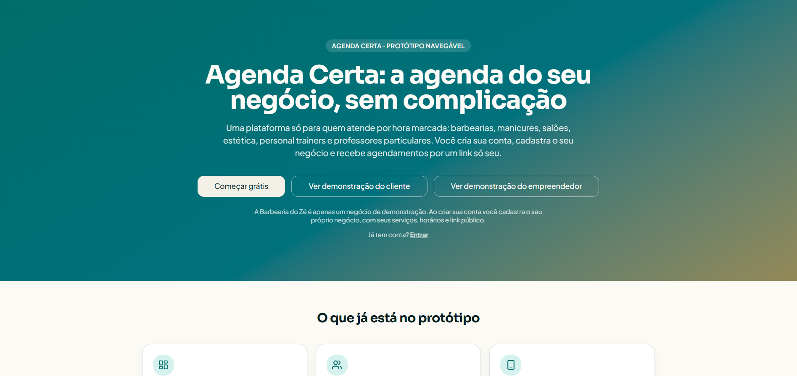
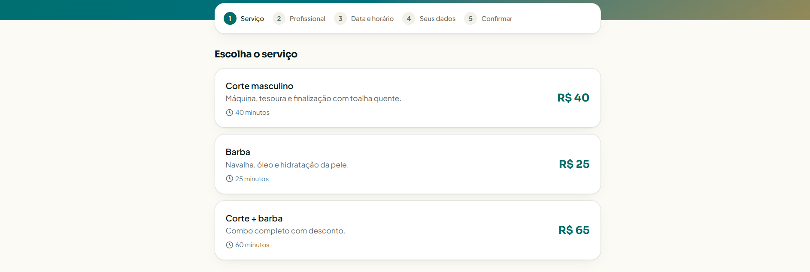
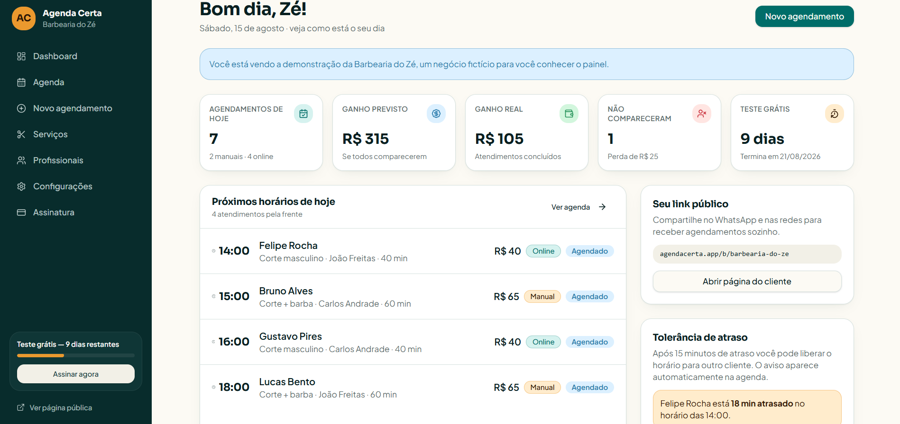

# Agenda Certa

**Uma agenda online por link próprio para quem trabalha com horário marcado.**

O Agenda Certa é um projeto de Micro SaaS para pequenos negócios e profissionais de serviços — como barbearias, salões, manicures e estúdios de estética. A proposta é substituir a organização dispersa de horários por uma página de agendamento de cada negócio e um painel simples para acompanhar atendimentos. **Não é um marketplace.**

> **Estado atual:** protótipo visual navegável (snapshot v0.2). Os fluxos usam dados fictícios e estado local; ainda não há autenticação, banco, Supabase conectado, agendamentos persistidos ou pagamentos reais.

## Demonstração do protótipo

> **Nota:** As imagens apresentam o protótipo visual do Agenda Certa. Todos os dados exibidos são fictícios e utilizados exclusivamente para demonstração das funcionalidades planejadas. O sistema ainda está em desenvolvimento.

As capturas abaixo são telas reais do protótipo, não imagens geradas. Nomes de clientes, estabelecimentos e profissionais, agendamentos, valores financeiros e indicadores são meramente ilustrativos: não representam operações reais. Não há banco de dados funcional nem agendamentos persistidos.



*Landing page: apresentação do produto e acesso às demonstrações.*



*Página do cliente: etapas do agendamento e serviços de um negócio fictício. O cabeçalho com contato foi removido da captura.*



*Painel do empreendedor: resumo e indicadores fictícios, sem backend funcional.*

## O que é possível explorar

| Jornada | O que o protótipo mostra |
| --- | --- |
| Empreendedor | Landing page, cadastro e login **simulados**, onboarding em seis etapas e painel com resumo do dia. |
| Operação | Agenda com filtros, ações de status, edição básica e bloqueios visuais; serviços e profissionais ativos/inativos; horários com múltiplos períodos por dia. |
| Cliente | Página pública própria em `/b/:slug`, escolha de serviço, profissional quando necessário, data e horário, confirmação e gerenciamento visual por código. |
| Configurações | Tolerância de atraso entre 5 e 60 minutos, períodos de atendimento e dias fechados, ainda sem gravação no servidor. |

A **Barbearia do Zé** é apenas um cenário fictício para demonstrar as telas. O código gerado na confirmação não é recuperado pela busca de agendamentos: essa busca apresenta um exemplo fixo. A disponibilidade, o cancelamento e a remarcação ainda não aplicam regras reais no servidor.

## Tecnologias e ferramentas

- **Aplicação:** React 19, TypeScript, TanStack Start/Router, Vite 8 e Tailwind CSS 4.
- **Interface:** componentes Radix UI, ícones Lucide e estilos responsivos. Há JavaScript na configuração de ferramentas; a aplicação é majoritariamente TypeScript/TSX.
- **Fluxo de desenvolvimento:** Lovable para o protótipo visual, GitHub para versionamento e Codex para implementação, revisão e documentação.

**Planejado, não disponível na `main`:** Supabase, PostgreSQL, autenticação real, regras de acesso (RLS) e persistência. A preparação inicial da integração está em uma [PR draft separada](https://github.com/Vini-coder256/agenda-certa/pull/2), ainda não integrada.

## Como o projeto está organizado

```text
src/routes/       telas e rotas do aplicativo
src/components/   componentes reutilizáveis da interface
src/lib/          dados de demonstração e utilitários do protótipo
public/           arquivos estáticos
*.md              decisões de produto, escopo, fluxos e planos técnicos
```

TanStack Start estrutura as rotas e a renderização da aplicação. Isso **não** significa que já exista um backend de negócio: hoje as telas usam principalmente mocks e `useState`. O onboarding guarda parte da configuração em `localStorage`, somente no navegador e sem sincronização entre contas ou telas.

## Executar localmente

Pré-requisitos: Git e [Bun](https://bun.sh/) instalados. O repositório usa `bun.lock`.

```sh
git clone https://github.com/Vini-coder256/agenda-certa.git
cd agenda-certa
bun install --frozen-lockfile
bun run dev
```

Abra o endereço exibido no terminal. Na landing page, use **Ver demonstração do cliente** ou **Ver demonstração do empreendedor**. Não informe dados reais no protótipo: formulários e agendamentos são demonstrações, sem conta ou armazenamento seguro.

Para conferir a versão de produção localmente, use `bun run build`. Nenhuma credencial de Supabase é necessária para executar a `main`.

## Próximas etapas

1. Revisar e integrar, quando aprovada, a fundação Supabase da PR draft.
2. Implementar banco, autenticação do empreendedor e isolamento de dados com RLS.
3. Substituir mocks por agendamentos persistidos e disponibilidade calculada no servidor, protegendo contra reservas simultâneas.
4. Completar gerenciamento do cliente, estados especiais da página pública e painel administrativo mínimo.
5. Implementar assinatura e pagamento apenas em uma etapa posterior, conforme o escopo do produto.

Este roadmap descreve intenção, não funcionalidades já entregues. O [plano de implementação](BACKEND_IMPLEMENTATION_PLAN.md) detalha fases e limites.

## Documentação

| Documento | Conteúdo |
| --- | --- |
| [Estado atual do protótipo](CURRENT_PROTOTYPE_SNAPSHOT.md) | O que funciona visualmente, mocks e limitações observadas no snapshot v0.2. |
| [Contexto do projeto](PROJECT_CONTEXT.md) e [escopo do MVP](MVP_SCOPE.md) | Problema, público, regras oficiais e primeira versão funcional pretendida. |
| [Fluxo de telas](SCREEN_FLOW.md) | Jornadas do empreendedor e do cliente e estados de interface. |
| [Plano de backend](BACKEND_IMPLEMENTATION_PLAN.md) e [plano de dados](DATABASE_PLAN.md) | Arquitetura e segurança **planejadas**, ainda não implementadas. |
| [Registro de desenvolvimento](DEVELOPMENT_LOG.md) | Evolução das decisões e do protótipo. |
| [Orientações para agentes](AGENTS.md) | Instruções do projeto e integração com Lovable. |

A `main` é a referência principal de código e documentação. O projeto mantém o histórico de desenvolvimento e o sincronismo com Lovable; não reescreva commits já publicados.

---

**Projeto de portfólio em evolução.** O foco atual é validar a experiência de agendamento e construir a base técnica com segurança, sem apresentar o protótipo como produto pronto para produção.
